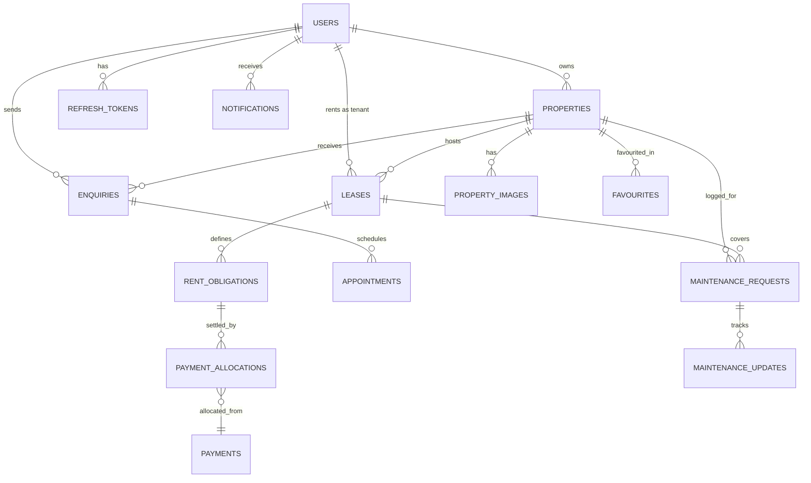

# EstateOS — Master Architecture & Project Blueprint

> **System Classification**: Full-Lifecycle Rental Operations & Property Management Platform  
> **Philosophy**: Connected workflows over isolated CRUD; strict relational integrity; zero-trust type safety.

---

## 1. System Vision & Architecture Overview

EstateOS is engineered around the unbroken rental lifecycle:
$$\text{Discovery} \longrightarrow \text{Enquiry} \longrightarrow \text{Visit Appointment} \longrightarrow \text{Lease Agreement} \longrightarrow \text{Rent Obligations} \longrightarrow \text{Maintenance Workflow}$$

### Monorepo Structure
```text
EstateOS/
├── apps/
│   ├── web/                    # React 19 + Vite + Tailwind CSS v4 + shadcn/ui
│   └── api/                    # Node.js 24 + Express 5 + TypeScript + Prisma v7
├── packages/
│   └── shared/                 # Shared TypeScript interfaces, Zod schemas, DTOs
├── docker/
│   ├── docker-compose.yml      # Local PostgreSQL & Redis (optional)
│   ├── Dockerfile.web
│   └── Dockerfile.api
├── .github/
│   └── workflows/
│       ├── ci.yml              # Vitest + Supertest + Playwright + Linter
│       └── cd.yml              # Build checks & Containerization
├── prisma/
│   └── schema.prisma           # Normalized Relational Schema
└── docs/
    ├── openapi.yaml            # REST API Specification
    └── er-diagram.png
```

---

## 2. Definitive Tech Stack & Boundaries

| Component | Choice & Version | Strategic Rationale |
| :--- | :--- | :--- |
| **Frontend Framework** | **React 19** | Automatic React Compiler, modern `use()` hook, native Actions. |
| **Frontend Tooling** | **Vite 6** | Ultra-fast HMR, native ESM support. |
| **UI & Styling** | **Tailwind CSS v4 + shadcn/ui** | CSS-first `@theme` configuration, zero-runtime overhead, accessible primitives. |
| **Client State / Cache** | **TanStack Query v5** | Server-state caching, automatic background refetching, mutation invalidation. |
| **Client Routing** | **React Router v7** | Standardized declarative routing with type-safe route params. |
| **Maps** | **Leaflet + OpenStreetMap** | Open-source, zero API-key dependencies, mobile-responsive interactive maps. |
| **Backend Runtime** | **Node.js 24 LTS** | Active long-term stability, native fetch & test runner enhancements. |
| **HTTP Framework** | **Express.js v5** | Express 5 stable release; robust middleware pipeline with modern async handler support. |
| **Type Safety** | **TypeScript 5.x** | End-to-end type safety shared between frontend and backend. |
| **ORM & Database** | **Prisma ORM v7 + PostgreSQL 16** | Strict migrations, relational integrity, query inspection, connection pooling. |
| **Validation** | **Zod v4** | Shared schema validation across HTTP request boundary and forms. |
| **Authentication** | **JWT (Access 15m + Refresh 7d)** | Stateless authorization checks + revocation via DB refresh token rotation. |
| **Media Storage** | **Cloudinary API** | Managed cloud media uploads with auto WebP optimization and secure signing. |
| **Testing** | **Vitest + Supertest + Playwright** | Fast unit/integration API tests + complete Golden E2E browser automation. |

---

## 3. Database Schema Design (Entity Relationship)



### Table Specifications & Constraints

1. **`users`**
   - `id`: UUID (Primary Key)
   - `name`: VARCHAR(255)
   - `email`: VARCHAR(255) UNIQUE NOT NULL
   - `password_hash`: VARCHAR(255) NOT NULL
   - `role`: ENUM (`OWNER`, `TENANT`, `ADMIN`) NOT NULL
   - `phone`: VARCHAR(20)
   - `created_at`: TIMESTAMP DEFAULT NOW()

2. **`properties`**
   - `id`: UUID (Primary Key)
   - `owner_id`: UUID (FK -> users.id, ON DELETE RESTRICT)
   - `title`: VARCHAR(255) NOT NULL
   - `description`: TEXT NOT NULL
   - `property_type`: ENUM (`APARTMENT`, `VILLA`, `STUDIO`, `COMMERCIAL`)
   - `rent_price`: DECIMAL(12,2) NOT NULL
   - `deposit_price`: DECIMAL(12,2) NOT NULL
   - `address`: VARCHAR(255) NOT NULL
   - `city`: VARCHAR(100) NOT NULL
   - `state`: VARCHAR(100) NOT NULL
   - `latitude`: DECIMAL(10,7)
   - `longitude`: DECIMAL(10,7)
   - `bedrooms`: INT NOT NULL
   - `bathrooms`: INT NOT NULL
   - `area_sqft`: INT NOT NULL
   - `status`: ENUM (`AVAILABLE`, `RENTED`, `MAINTENANCE`, `UNLISTED`) DEFAULT 'AVAILABLE'
   - `created_at`: TIMESTAMP DEFAULT NOW()

3. **`property_images`**
   - `id`: UUID (Primary Key)
   - `property_id`: UUID (FK -> properties.id, ON DELETE CASCADE)
   - `image_url`: VARCHAR(1024) NOT NULL
   - `public_id`: VARCHAR(255) NOT NULL
   - `is_primary`: BOOLEAN DEFAULT FALSE

4. **`leases`**
   - `id`: UUID (Primary Key)
   - `property_id`: UUID (FK -> properties.id)
   - `tenant_id`: UUID (FK -> users.id)
   - `start_date`: DATE NOT NULL
   - `end_date`: DATE NOT NULL
   - `monthly_rent`: DECIMAL(12,2) NOT NULL
   - `deposit_amount`: DECIMAL(12,2) NOT NULL
   - `status`: ENUM (`ACTIVE`, `TERMINATED`, `EXPIRED`, `PENDING_SIGNATURE`)
   - *Constraint*: `EXCLUDE (property_id WITH =, daterange(start_date, end_date, '[]') WITH &&) WHERE (status = 'ACTIVE')` (Prevents overlapping active leases).

5. **`rent_obligations`**
   - `id`: UUID (Primary Key)
   - `lease_id`: UUID (FK -> leases.id, ON DELETE CASCADE)
   - `due_date`: DATE NOT NULL
   - `amount_due`: DECIMAL(12,2) NOT NULL
   - `amount_paid`: DECIMAL(12,2) DEFAULT 0.00
   - `status`: ENUM (`PENDING`, `PARTIALLY_PAID`, `PAID`, `OVERDUE`)

6. **`payments` & `payment_allocations`**
   - Simulates rent remittance, generating verifiable payment allocation ledger entries without double-crediting.

7. **`maintenance_requests` & `maintenance_updates`**
   - `id`: UUID (Primary Key)
   - `property_id`: UUID (FK -> properties.id)
   - `tenant_id`: UUID (FK -> users.id)
   - `title`: VARCHAR(255) NOT NULL
   - `description`: TEXT NOT NULL
   - `priority`: ENUM (`LOW`, `MEDIUM`, `HIGH`, `EMERGENCY`)
   - `status`: ENUM (`SUBMITTED`, `ASSIGNED`, `IN_PROGRESS`, `RESOLVED`, `CANCELLED`)
   - `image_url`: VARCHAR(1024)
   - Audit updates record timestamps, status changes, and technician notes.

---

## 4. The Rental Reliability Engine (Deterministic Core)

The system computes operational signals directly from Postgres rows using pure database queries without fragile LLM calls:

```sql
-- Example: Overdue Rent Detection Signal
SELECT 
  ro.id AS obligation_id,
  l.property_id,
  l.tenant_id,
  ro.amount_due - ro.amount_paid AS balance_due,
  CURRENT_DATE - ro.due_date AS days_overdue
FROM rent_obligations ro
JOIN leases l ON ro.lease_id = l.id
WHERE ro.status != 'PAID'
  AND ro.due_date < CURRENT_DATE
  AND l.status = 'ACTIVE';
```

### Dashboard Signals:
1. **Urgent Rent Due / Overdue**: Flagged when `CURRENT_DATE >= due_date - INTERVAL '3 days'` or overdue.
2. **Vacancy Risk & Lease Expiry**: Flagged when `leases.end_date <= CURRENT_DATE + INTERVAL '30 days'`.
3. **Pending Maintenance Aging**: Ranked by `priority` and days elapsed since `created_at`.
4. **Upcoming Visit Appointments**: Scheduled visits in the next 24-48 hours.

---

## 5. Phased Execution Roadmap

### Phase 1: Foundation & Project Scaffolding
- [ ] Initialize repository structure (`apps/api`, `apps/web`, `packages/shared`).
- [ ] Configure TypeScript configs (`tsconfig.json`), ESLint, and Prettier.
- [ ] Setup Prisma schema with PostgreSQL models and enum definitions.
- [ ] Set up Docker Compose for local PostgreSQL 16 database.
- [ ] Implement initial OpenAPI / REST route specification.

### Phase 2: Authentication & RBAC Engine
- [ ] JWT authentication pipeline (Short-lived access token + Refresh token rotation).
- [ ] Password hashing with `bcrypt` (12 rounds).
- [ ] Role-Based Access Control middleware (`requireAuth`, `requireRole('OWNER' | 'TENANT' | 'ADMIN')`).
- [ ] API integration tests for unauthorized, forbidden, and token expiration edge cases.

### Phase 3: Property Lifecycle & Media Management
- [ ] Owner Property CRUD with strict ownership verification.
- [ ] Cloudinary secure direct upload / backend signing integration.
- [ ] Public marketplace query API: filtering by price range, bedroom count, location search, and pagination.
- [ ] Leaflet integration on frontend for interactive geographical map discovery.

### Phase 4: Enquiries & Visit Appointment Scheduling
- [ ] Renter enquiry submission and Owner inbox review.
- [ ] Appointment booking with slot validation and conflict checks.
- [ ] Appointment status flow (`PENDING` -> `APPROVED` | `RESCHEDULED` | `REJECTED` | `COMPLETED`).

### Phase 5: Lease Management & Financial Obligations
- [ ] Lease agreement generation with overlap prevention constraints.
- [ ] Rent obligation auto-generator (monthly schedules based on lease term).
- [ ] Payment settlement recording with partial payment allocation.
- [ ] Tenant payment history ledger and printable receipts.

### Phase 6: Maintenance Ticketing System
- [ ] Tenant maintenance request submission with photo attachments.
- [ ] Owner ticketing dashboard with status workflow and resolution notes.
- [ ] Audit timeline for each ticket (`SUBMITTED` -> `IN_PROGRESS` -> `RESOLVED`).

### Phase 7: The Rental Reliability Engine & Analytics Dashboard
- [ ] Aggregated metrics computation: occupancy rate, gross revenue, overdue receivables.
- [ ] Proactive action cards (overdue rent alerts, expiring leases, pending viewings).
- [ ] Recharts data visualizations for income trends and maintenance turnaround.

### Phase 8: Quality Assurance & Deployment Readiness
- [ ] Vitest unit and integration test suite (covering positive and negative test cases).
- [ ] Playwright Golden E2E Test Suite (Full Renter -> Owner -> Lease -> Maintenance lifecycle).
- [ ] Multi-stage production `Dockerfile`s and CI workflow setup (`.github/workflows/ci.yml`).
